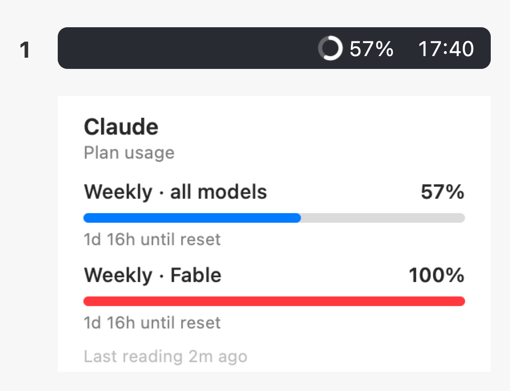

# Kullanım

A small menu bar app for macOS that always shows how much of your Claude plan you have used this week.



The ring and the number show the weekly limit for all models. Click it to see every limit (for example a per-model weekly limit) with its reset time. The ring turns orange at 70% and red at 90%. It fades when the last reading is more than 3 hours old.

## Install

Paste this into Terminal:

```bash
curl -fsSL https://raw.githubusercontent.com/sahintekten/kullanim/main/install.sh | bash
```

No GitHub account is needed. The app is built on your Mac, so it needs Apple's Command Line Tools; if they are missing, the installer starts their setup and you run the command again afterwards. Requires macOS 13 or later.

Then, once, in Google Chrome:

1. Go to `chrome://extensions`
2. Turn on **Developer mode** (top right)
3. Click **Load unpacked** and choose the folder `~/Applications/Kullanim Chrome` (the installer opens it in Finder)

Stay signed in to claude.ai in Chrome. The extension reads your usage every 3 minutes, even when no claude.ai tab is open, as long as Chrome is running.

## How it works

- The Chrome extension asks claude.ai for the same usage figures its own usage page shows, using the session you are already signed in with.
- It hands only the percentages and reset times to the menu bar app through Chrome's native messaging. Your login never leaves the browser and nothing is sent anywhere else.
- The app writes the reading to `~/.claude/kullanim.json` and redraws the menu bar from it.

The usage data claude.ai serves is not a documented API, so a change on their side can break the reading until this app is updated.

### Optional: Claude Code desktop

If you use Claude Code, the `mod` folder in this repository is a Claude Code mod that writes the same file from inside your sessions (it also works when Chrome is closed). To load it in every new session, add this to `~/.claude/settings.json`, pointing at where you keep the folder:

```json
"env": { "CLAUDE_CODE_PLUGIN_DIRS": "/path/to/kullanim/mod" }
```

## Uninstall

```bash
curl -fsSL https://raw.githubusercontent.com/sahintekten/kullanim/main/uninstall.sh | bash
```

Then remove the "Kullanım göstergesi" extension at `chrome://extensions`.

## Türkçe

Claude planının bu haftaki kullanımını menü çubuğunda sürekli gösteren küçük bir Mac uygulaması. Halka ve rakam tüm modellerin haftalık sınırıdır; tıklayınca model bazlı sınırlar ve sıfırlanma zamanları da görünür.

Kurmak için Terminal'e yapıştır:

```bash
curl -fsSL https://raw.githubusercontent.com/sahintekten/kullanim/main/install.sh | bash
```

Sonra Chrome'da bir kez: `chrome://extensions` → sağ üstte **Developer mode** → **Load unpacked** → `~/Applications/Kullanim Chrome` klasörü. Chrome'da claude.ai'ye giriş yapmış kal; okuma 3 dakikada bir yenilenir. Giriş bilgin tarayıcıdan çıkmaz, göstergeye yalnız yüzdeler gider.

## License

[MIT](LICENSE)
